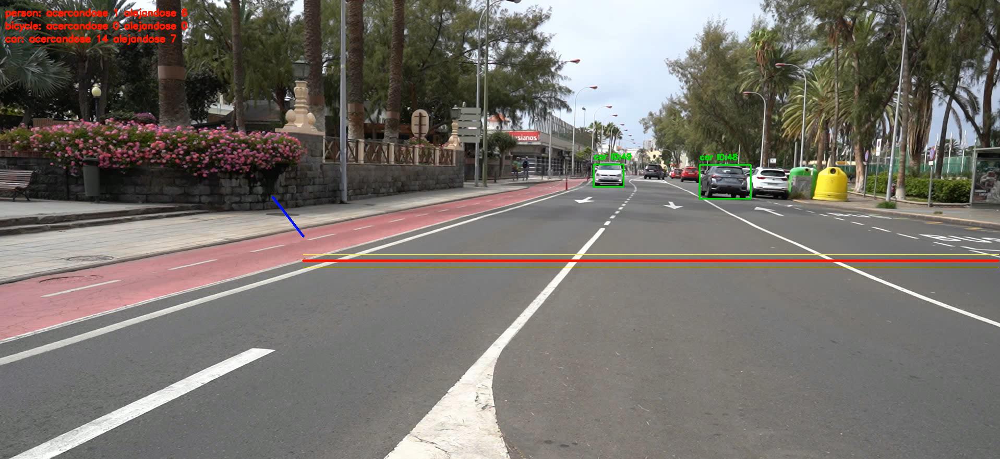
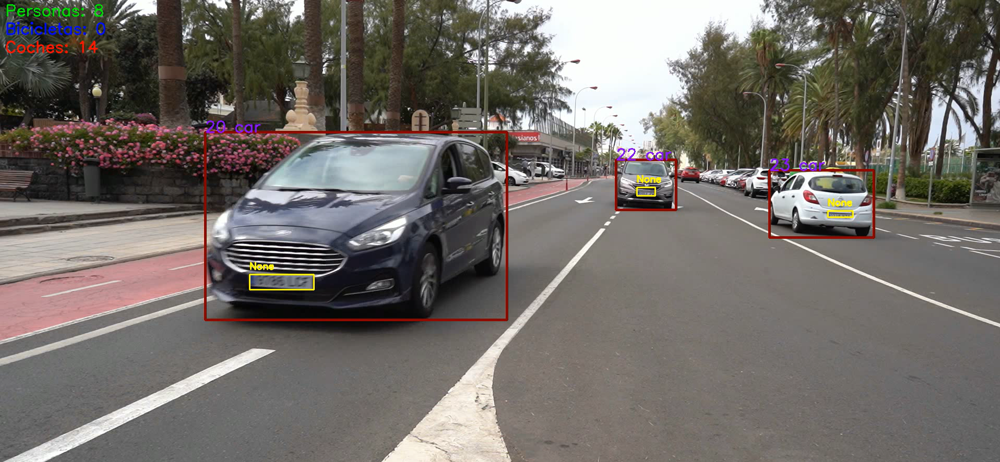
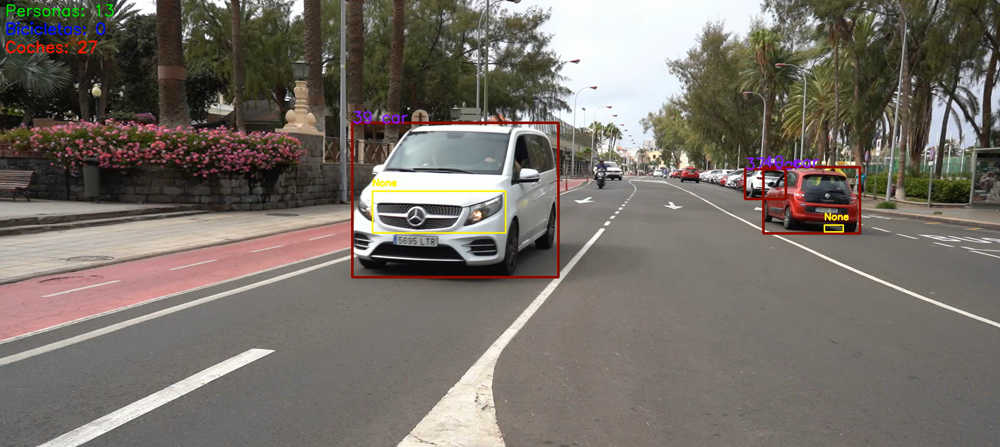
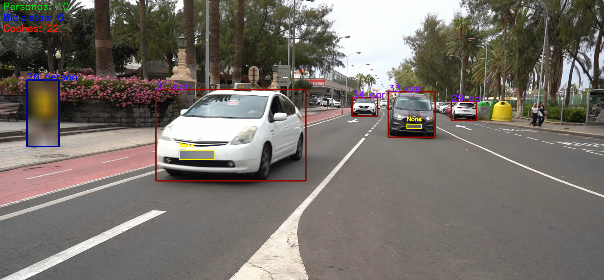

# Práctica 4 – Detección y seguimiento de vehículos y matrículas

## 1. Introducción

En esta práctica se desarrolla un sistema de visión por computador orientado al análisis y procesado de vídeos de tráfico. El objetivo principal es detectar y realizar el seguimiento de coches, personas, bicicletas y matrículas presentes en este [vídeo][C0142.MP4].

Para ello, se utiliza YOLO como modelo de detección de objetos, tanto mediante un modelo preentrenado como mediante uno entrenado específicamente para localizar matrículas. Además, se incorporan diferentes funcionalidades para analizar el sentido de circulación, contabilizar los objetos detectados y anonimizar determinadas regiones de los vídeos.

Además, el sistema permite trabajar con dos métodos para localizar matrículas: un modelo YOLO entrenado con un conjunto de imágenes anotadas y un método basado en el análisis de contornos mediante OpenCV.

## 2. Detección y seguimiento de objetos

Para la detección de los elementos presentes en el vídeo se utiliza el modelo **YOLO11n**, que permite identificar tres clases de objetos:

- Personas.
- Bicicletas.
- Coches.

A partir de las detecciones, se realiza el seguimiento de los objetos a lo largo de los fotogramas. De esta manera, se mantiene un identificador para cada elemento y se puede seguir su movimiento durante el vídeo.

Esta información también permite evitar que un mismo objeto sea contabilizado varias veces cuando aparece en diferentes fotogramas.

## 3. Análisis del sentido de circulación

Una de las funcionalidades implementadas consiste en determinar el sentido de desplazamiento de los objetos detectados.

Para ello, se establecen líneas de referencia sobre el vídeo y se analiza cómo se desplazan los objetos respecto a ellas. En función de su movimiento, se clasifican como objetos que se acercan o se alejan.

Se mantienen contadores independientes para personas, bicicletas y coches, permitiendo obtener un resumen del tráfico observado.

## 4. Detección de matrículas

Para localizar las matrículas de los vehículos se han implementado dos métodos diferentes.

### 4.1. Detección mediante YOLO entrenado

Se utiliza un modelo YOLO11n como punto de partida, que posteriormente se entrena con el dataset desarrollado por los compañeros de la asignatura, que contiene un conjunto de imágenes anotadas para la detección de matrículas.

El conjunto de datos se organiza separando las imágenes en tres particiones:

- **Train:** imágenes utilizadas durante el entrenamiento.
- **Validation:** imágenes utilizadas para comprobar el comportamiento del modelo durante el entrenamiento.
- **Test:** imágenes reservadas para evaluar el modelo una vez finalizado el entrenamiento.

El conjunto de datos contiene una única clase, denominada `matricula`.

La configuración utilizada durante el entrenamiento es la siguiente:

| Parámetro | Valor |
|---|---|
| Modelo inicial | YOLO11n |
| Épocas | 100 |
| Paciencia | 20 |
| Tamaño de imagen | 640 × 640 |
| Batch | 8 |
| Dispositivo | GPU, si está disponible; en caso contrario, CPU |

Una vez terminado el entrenamiento, se utiliza el mejor modelo obtenido (`best.pt`) para realizar las detecciones.

### 4.2. Detección mediante contornos

Como alternativa al modelo entrenado, se ha implementado un método de detección basado en operaciones de procesamiento de imágenes con OpenCV.

En este caso, primero se localizan los coches mediante YOLO11n y, posteriormente, se analiza individualmente la región de cada vehículo para intentar localizar su matrícula.

El procedimiento aplicado es el siguiente:

1. Se convierte la región del vehículo a escala de grises.
2. Se aplica un desenfoque gaussiano para reducir el ruido.
3. Se utiliza el detector de bordes Canny para localizar los cambios de intensidad.
4. Se aplica una operación morfológica de cierre para unir regiones próximas.
5. Se extraen los contornos y se analizan sus dimensiones y proporciones.

Finalmente, se seleccionan los candidatos que cumplen determinados criterios geométricos, como el ancho, el alto, la relación de aspecto y el área.

Este método permite localizar algunas matrículas, aunque sus resultados son menos consistentes que los obtenidos mediante el modelo entrenado. Esto se debe principalmente a que otras partes del vehículo, como elementos de la carrocería o sombras, pueden presentar características geométricas similares a las de una matrícula.

## 5. Anonimización de matrículas y personas

También se ha incorporado una funcionalidad de anonimización que permite aplicar un desenfoque gaussiano sobre las regiones de las matrículas y las personas detectadas.

A la hora de ejecutar el programa, aparecerá una caja de texto en la que el usuario debe decidir si la detección se hará por contornos o no. Debido a este sistema de preguntas al usuario, es posible tener muchas funcionalidades diferentes en un código compacto.

Para las matrículas se utiliza el modelo entrenado, mientras que las personas se localizan mediante el modelo YOLO11n general. Una vez obtenidas las regiones correspondientes, se aplica un desenfoque gaussiano con un tamaño de kernel de 51 × 51 y una desviación estándar de 30.

En el caso de las matrículas, también se relacionan las detecciones con los vehículos correspondientes. Para ello, se comprueba si el centro de la matrícula se encuentra dentro de la región delimitada por el vehículo.

Cuando se detectan varias matrículas asociadas a un mismo coche, se selecciona la que presenta una mayor confianza.

## 6. Archivo CSV

Cuando se utiliza el método de detección de matrículas mediante YOLO, se genera el archivo `C0142_resultados.csv`.

Este archivo recoge información de las detecciones realizadas durante el procesamiento del vídeo, incluyendo:

- Número de fotograma.
- Tipo de objeto detectado.
- Confianza de la detección.
- Identificador de seguimiento.
- Coordenadas de la región detectada.
- Información asociada a la matrícula localizada.

El archivo permite conservar los resultados del procesamiento para su posterior consulta y análisis, y puede ser consultado [aquí][C0142_resultados.csv].

## 7. Conclusiones

Durante el desarrollo de esta parte de la práctica se ha implementado un sistema capaz de detectar y realizar el seguimiento de diferentes objetos presentes en vídeos de tráfico.

Además de la detección general, se han incorporado funcionalidades para analizar el sentido de circulación y contabilizar los objetos que se acercan o se alejan. También se han desarrollado dos métodos para localizar matrículas, lo que permite comparar un enfoque basado en un modelo entrenado con otro basado en operaciones tradicionales de procesamiento de imágenes.

Por último, se ha añadido la posibilidad de anonimizar matrículas y personas, así como generar archivos CSV con información de las detecciones.

Los resultados obtenidos permiten comprobar las posibilidades de estas técnicas para el análisis de vídeos de tráfico, así como las diferencias entre los métodos utilizados para localizar matrículas.