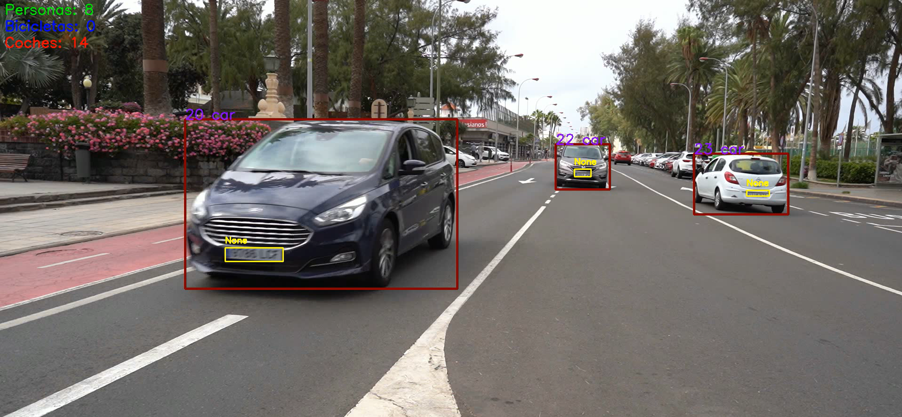
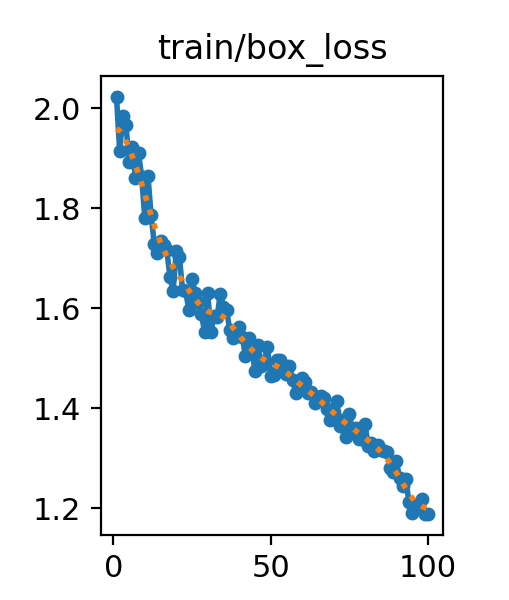
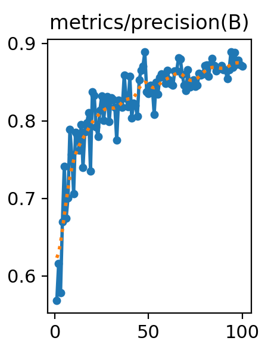
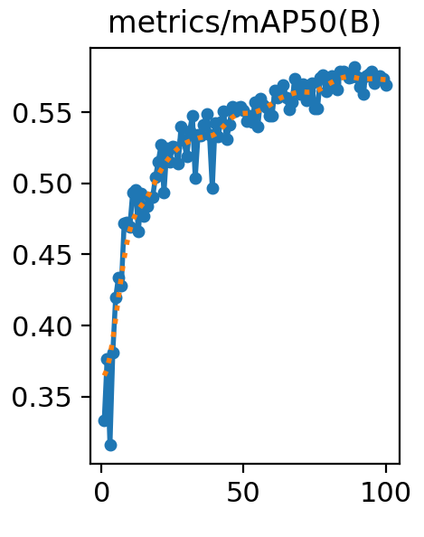
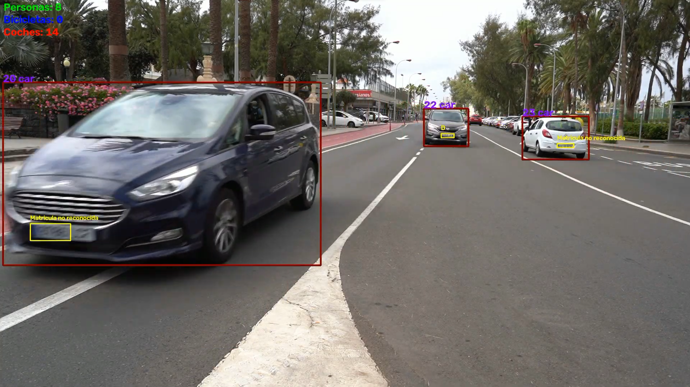
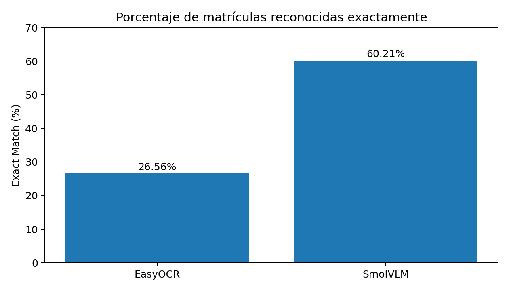
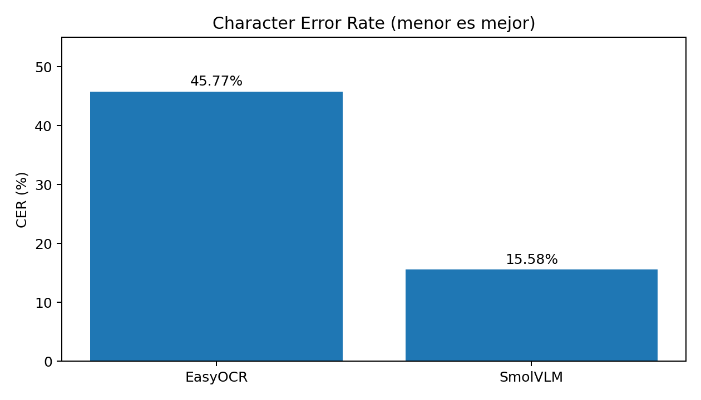
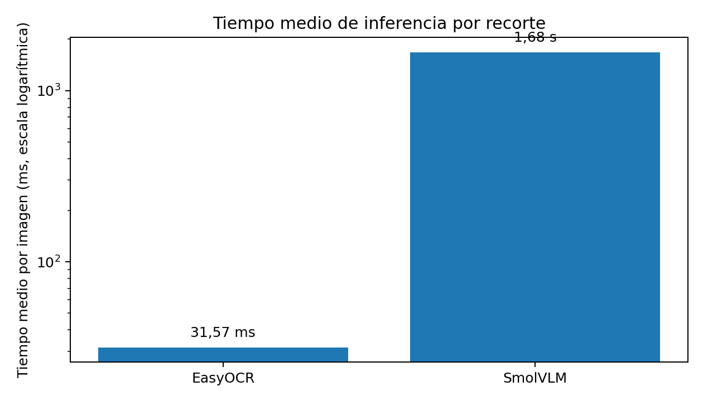

# Práctica 4 – Detección y seguimiento de vehículos y matrículas

## 1. Introducción

En esta práctica se desarrolla un sistema de visión por computador orientado al análisis y procesado de vídeos de tráfico. El objetivo principal es detectar y realizar el seguimiento de coches, personas, bicicletas y matrículas presentes en este [vídeo](https://drive.google.com/file/d/13_jrGrxRbnmeE6TLGrElZA5Xu7BUczPr/view?usp=drive_link). Se recomienda dar clic a las imágenes proporcionadas, ya que dirigen directamente al vídeo correspondiente de cada apartado.

Para ello, se utiliza YOLO como modelo de detección de objetos, tanto mediante un modelo preentrenado como mediante uno entrenado específicamente para localizar matrículas. Además, se incorporan diferentes funcionalidades para analizar el sentido de circulación, contabilizar los objetos detectados y anonimizar determinadas regiones de los vídeos.

Además, el sistema permite trabajar con dos métodos para localizar matrículas: un modelo YOLO entrenado con un conjunto de imágenes anotadas y un método basado en el análisis de contornos mediante OpenCV.

Por otro lado, la segunda parte de la práctica se da un paso más, además de localizar las matrículas de los vehículos, queremos conseguir leer los caracteres que aparecen en ellas.

Durante la realización se aprovecha el detector YOLO desarrollado anteriormente y se incorporan modelos de reconocimiento de texto (OCR). Este apartado se divide en dos partes. Primero, se integra EasyOCR en el procesamiento en el [vídeo de tráfico](https://drive.google.com/file/d/13_jrGrxRbnmeE6TLGrElZA5Xu7BUczPr/view?usp=drive_link), ya nombrado anteriormente, para intentar reconocer las matrículas y guardar los resultados. Después, se prepara un conjunto de recortes de matrículas con sus textos reales para comparar EasyOCR con otro modelo, SmolVLM.

## 2. Detección y seguimiento de objetos

Para la detección de los elementos presentes en el vídeo se utiliza el modelo **YOLO11n**, que permite identificar tres clases de objetos:

- Personas.
- Bicicletas.
- Coches.

A partir de las detecciones, se realiza el seguimiento de los objetos a lo largo de los fotogramas. De esta manera, se mantiene un identificador para cada elemento y se puede seguir su movimiento durante el vídeo. Esta información también permite evitar que un mismo objeto sea contabilizado varias veces cuando aparece en diferentes fotogramas.

## 3. Análisis del sentido de circulación

Una de las funcionalidades implementadas consiste en determinar el sentido de desplazamiento de los objetos detectados.

Para ello, se establecen líneas de referencia sobre el vídeo y se analiza cómo se desplazan los objetos respecto a ellas. En función de su movimiento, se clasifican como objetos que se acercan o se alejan.

Se mantienen contadores independientes para personas, bicicletas y coches, permitiendo obtener un resumen del tráfico observado.

## 4. Detección de matrículas

Para localizar las matrículas de los vehículos se han implementado dos métodos diferentes.

### 4.1. Detección mediante YOLO entrenado

Se utiliza un modelo YOLO11n como punto de partida, que posteriormente se entrena con el [dataset](https://drive.google.com/drive/folders/1RFd6sKH_QMQcpE_w5rWmy8rKiYUY5_SI?usp=drive_link) desarrollado por los compañeros de la asignatura, que contiene un conjunto de imágenes anotadas para la detección de matrículas.

El conjunto de datos se organiza separando las imágenes en tres particiones:

- **Train:** imágenes utilizadas durante el entrenamiento (70%).
- **Validation:** imágenes utilizadas para comprobar el comportamiento del modelo durante el entrenamiento (20%).
- **Test:** imágenes reservadas para evaluar el modelo una vez finalizado el entrenamiento (10%).

El conjunto de datos contiene una única clase, denominada `matricula`.

La configuración utilizada durante el entrenamiento es la siguiente:

| Parámetro | Valor |
|---|---|
| Modelo inicial | YOLO11n |
| Épocas | 100 |
| Paciencia | 20 |
| Tamaño de imagen | 640 × 640 |
| Batch | 8 |
| Dispositivo | GPU, si está disponible; en caso contrario, CPU |

Una vez terminado el entrenamiento, se utiliza el mejor modelo obtenido (`best.pt`) para realizar las detecciones.

### 4.2. Detección mediante contornos

Como alternativa al modelo entrenado, se ha implementado un método de detección basado en operaciones de procesamiento de imágenes con OpenCV. En este caso, primero se localizan los coches mediante YOLO11n y, posteriormente, se analiza individualmente la región de cada vehículo para intentar localizar su matrícula.

El procedimiento aplicado es el siguiente:

1. Se convierte la región del vehículo a escala de grises.
2. Se aplica un desenfoque gaussiano para reducir el ruido.
3. Se utiliza el detector de bordes Canny para localizar los cambios de intensidad.
4. Se aplica una operación morfológica de cierre para unir regiones próximas.
5. Se extraen los contornos y se analizan sus dimensiones y proporciones.

Finalmente, se seleccionan los candidatos que cumplen determinados criterios, como el ancho, el alto, la relación de aspecto y el área.

Este método permite localizar muy pocas matrículas, ya que sus resultados son menos consistentes que los obtenidos mediante el modelo entrenado. Esto se debe principalmente a que otras partes del vehículo, como elementos de la carrocería o sombras, pueden presentar características geométricas similares a las de una matrícula.

A la hora de ejecutar el programa, aparecerá una caja de texto en la que el usuario debe decidir si la detección se hará por contornos o no. Debido a este sistema de preguntas al usuario, es posible tener muchas funcionalidades diferentes en un código compacto.

## 5. Anonimización de matrículas y personas

También se ha incorporado una funcionalidad de anonimización que permite aplicar un desenfoque gaussiano sobre las regiones correspondientes a las matrículas y las personas detectadas. Para utilizarla, cuando el programa pregunte si se desea aplicar el análisis de contornos, se deberá responder `n`. A continuación, se preguntará si se desea anonimizar las personas y las matrículas detectadas.

Para las matrículas se utiliza el modelo entrenado, mientras que las personas se localizan mediante el modelo YOLO11n general. Una vez obtenidas las regiones correspondientes, se aplica un desenfoque gaussiano con un tamaño de kernel de 51 × 51 y una desviación estándar de 30.

En el caso de las matrículas, también se relacionan las detecciones con los vehículos correspondientes. Para ello, se comprueba si el centro de la matrícula se encuentra dentro de la región delimitada por el vehículo.

Cuando se detectan varias matrículas asociadas a un mismo coche, se selecciona la que presenta una mayor confianza.

## 6. Archivo CSV

Cuando se utiliza el método de detección de matrículas mediante YOLO, se genera el archivo `C0142_resultados.csv`.

Este archivo recoge información de las detecciones realizadas durante el procesamiento del vídeo, incluyendo:

- Número de fotograma.
- Tipo de objeto detectado.
- Confianza de la detección.
- Identificador de seguimiento.
- Coordenadas de la región detectada.
- Información asociada a la matrícula localizada.

El archivo permite conservar los resultados del procesamiento para su posterior consulta y análisis, y puede ser consultado [aquí](P4/C0142_resultados.csv).

Al realizar una inspección sobre el documento, se observa que sólo consigue detectar correctamente 2 matrículas.

## 7. – Reconocimiento de caracteres en matrículas

### 7.1. Entrenamiento del detector de matrículas

Antes de poder leer los caracteres, necesitamos localizar correctamente las matrículas dentro de cada imagen. Para ello, se entrenó un detector **YOLO11n** utilizando un conjunto de imágenes anotadas. En este caso, solo se utiliza una clase, `matricula`.

El entrenamiento se realizó durante **100 épocas**, con imágenes de tamaño 640x640. Durante este proceso, el modelo va comparando las cajas que predice con las anotaciones reales y ajusta sus parámetros para mejorar las detecciones. Al terminar, se seleccionaron los mejores pesos (`best.pt`), que son los que se utilizan posteriormente en el procesamiento del vídeo.

#### Evolución del entrenamiento

Para hacernos una idea de cómo ha aprendido el modelo, vamos a fijarnos en tres gráficas obtenidas durante el entrenamiento.

| Pérdida de entrenamiento | |
|---|---|
|  | Esta gráfica muestra el error que comete el modelo al localizar las matrículas. Concretamente, `box_loss` mide la diferencia entre las cajas que predice y las que aparecen en las anotaciones reales, teniendo en cuenta su posición y tamaño. Al principio el valor se encuentra alrededor de 2,0 y va bajando progresivamente hasta situarse cerca de 1,2 al final. Es una evolución favorable, ya que significa que el modelo va ajustando mejor la posición y las dimensiones de las matrículas. Además, la curva sigue bajando hasta la última época, aunque las mejoras son más pequeñas que al principio. |
| **Precisión** | |
|  | La precisión indica qué parte de las detecciones realizadas por el modelo son realmente matrículas. Por ejemplo, un valor de 0,85 significa que aproximadamente el 85 % de las detecciones son correctas. En la gráfica se aprecia una mejora bastante rápida durante las primeras épocas, se pasa de valores cercanos a 0,57 a superar el 0,8. Después aparecen algunas oscilaciones, pero la tendencia sigue siendo ascendente y termina alrededor de 0,87. Esto indica que el modelo ha aprendido a evitar mejor las detecciones falsas y que, cuando señala una posible matrícula, cada vez es más probable que haya acertado. |
| **Calidad de detección (mAP@0.5)** | |
|  | Esta métrica permite valorar la calidad general de las detecciones. Para calcularla se tiene en cuenta si el modelo encuentra las matrículas y si las cajas que dibuja coinciden suficientemente con las anotaciones reales. En concreto, se considera que una detección es correcta cuando la coincidencia entre ambas cajas (IoU) es de al menos un 50 %. En la gráfica se observa una mejora progresiva, especialmente al principio, hasta que los valores empiezan a estabilizarse. Esto indica que el modelo ha ido mejorando tanto al encontrar las matrículas como al delimitar su posición. |

#### Conclusiones del entrenamiento

En conjunto, las gráficas muestran que el modelo ha aprendido de forma progresiva. El error al localizar las matrículas disminuye durante todo el entrenamiento, mientras que la precisión y la calidad de las detecciones mejoran considerablemente respecto a las primeras épocas. También se aprecia que las mayores mejoras se producen al principio. A partir de ahí, los resultados se van estabilizando y los avances son más pequeños. Esto es bastante habitual cuando el modelo ya ha aprendido buena parte de las características que necesita para realizar las detecciones.

La precisión final, cercana al 0,87, es un resultado bueno, aunque no significa que el modelo consiga encontrar todas las matrículas. Para saber cuántas se le escapan también hay que tener en cuenta el *recall*, que se recoge en las métricas de validación.

Una vez tenemos el detector entrenado, lo incorporamos al procesamiento del vídeo de tráfico. El objetivo es que, cuando se localice una matrícula, podamos extraer su contenido y mostrarlo sobre el propio vídeo.

Para ello, se mantiene el detector general de objetos y el seguimiento de vehículos utilizados en la primera parte. Además, se utiliza el modelo YOLO entrenado para localizar las matrículas en cada fotograma.

Cuando se encuentra una matrícula, se recorta la región y se prepara la imagen antes de enviarla a EasyOCR. En este preprocesamiento se realizan los siguientes pasos:

1. Se convierte el recorte a escala de grises para trabajar con la información de intensidad de la imagen.
2. Se amplía cinco veces mediante interpolación cúbica, con la intención de facilitar la lectura de los caracteres.
3. Se mejora el contraste utilizando CLAHE, para intentar distinguir mejor los caracteres del fondo.
4. Se envía el resultado a EasyOCR, limitando los caracteres posibles a números y letras mayúsculas.

EasyOCR puede devolver varias lecturas para un mismo recorte. Cuando ocurre esto, se selecciona la que tiene una confianza mayor. El texto reconocido se muestra sobre el vídeo junto a la matrícula detectada.
 El resultado se guarda en un vídeo procesado, donde se pueden observar los vehículos, las matrículas localizadas y el texto reconocido por el OCR. Además, se genera el archivo `C0142_resultados_Ocr.csv`, que recoge información de las detecciones, como el fotograma, el tipo de objeto, la confianza, el identificador de seguimiento, las coordenadas y, cuando corresponde, el texto leído de la matrícula.

### 7.3. Preparación del conjunto ara la evaluación OCR

Para comparar los dos modelos OCR necesitamos utilizar imágenes cuyo contenido real conozcamos. Por eso, se preparó un conjunto de datos a partir de las imágenes y anotaciones JSON de un conjunto de datos creado por la clase ya nombrado anteriormente, [acceso](https://drive.google.com/drive/folders/1RFd6sKH_QMQcpE_w5rWmy8rKiYUY5_SI?usp=drive_link).

De cada imagen original se extrae la región correspondiente a la matrícula y se guarda junto con el texto que aparece en su anotación. Durante este proceso se descartan las anotaciones que no contienen una matrícula válida, ya que no servirían para comprobar si el reconocimiento es correcto.

Después de este filtrado se obtiene un conjunto de **975 recortes de matrículas**, cada uno acompañado de su correspondiente texto real.

Lo importante es que tanto EasyOCR como SmolVLM se evalúan utilizando exactamente estos mismos recortes y las mismas referencias. Así evitamos que las diferencias entre los resultados se deban a que un modelo haya recibido imágenes más fáciles que el otro.

El archivo `matriculas_reales.csv` contiene la información de los recortes y las matrículas reales utilizadas durante la evaluación.

### 7.4. Evaluación de EasyOCR

El primer modelo que se evalúa es **EasyOCR**, una herramienta de reconocimiento óptico de caracteres que permite extraer texto directamente de una imagen. Se utiliza el modelo preentrenado, sin realizar ningún entrenamiento adicional.

Se procesa cada uno de los 975 recortes y se compara el texto obtenido con la matrícula real. Además de comprobar si la lectura es correcta, se mide el tiempo.

Los resultados obtenidos son los siguientes:

| Métrica | Resultado |
|---|---:|
| Imágenes evaluadas | 975 |
| Predicciones correctas | 259 |
| Predicciones incorrectas | 716 |
| Predicciones vacías | 118 |
| Exact Match | **26,56 %** |
| CER | **45,77 %** |
| Tiempo total | 30,78 s |
| Tiempo medio por imagen | **31,57 ms** |

El resultado más llamativo es que EasyOCR solo consigue reconocer correctamente 259 de las 975 matrículas. Esto supone un **26,56 % de aciertos exactos**, por lo que en bastantes imágenes se equivoca en uno o varios caracteres.

También hay que tener en cuenta que 118 predicciones están vacías. Es decir, en esos casos EasyOCR no consigue devolver ningún texto. En el resto de las lecturas incorrectas sí obtiene algún resultado, pero no coincide completamente con la matrícula real.

Para valorar los errores de una forma más detallada se utiliza el **Character Error Rate (CER)**. Esta métrica compara los caracteres reconocidos con los reales y tiene en cuenta los caracteres sustituidos, insertados o eliminados. Cuanto menor sea el CER, mejor es el resultado. En este caso se obtiene un **45,77 %**, lo que refleja las dificultades que ha tenido EasyOCR para leer correctamente las matrículas.

Donde sí destaca claramente es en la velocidad. Procesar los 975 recortes le lleva aproximadamente 31 segundos, con una media de apenas 31,57 milisegundos por imagen. Por tanto, aunque sus resultados de reconocimiento no son especialmente buenos, es un modelo muy rápido.

### 7.5. Evaluación de SmolVLM

Como alternativa a EasyOCR, se prueba **SmolVLM-256M-Instruct**, un VLM con 256 millones de parámetros. A diferencia de un OCR tradicional, este modelo puede interpretar el contenido de una imagen y responder a una instrucción sobre ella.

En este caso, se le proporciona cada recorte junto con una indicación para que identifique los caracteres de la matrícula y devuelva el texto reconocido. Al igual que con EasyOCR, se utiliza el modelo preentrenado, sin realizar ningún entrenamiento adicional.

La evaluación se realiza sobre los mismos 975 recortes, por lo que podemos comparar directamente sus resultados con los del apartado anterior.

Los resultados obtenidos son los siguientes:

| Métrica | Resultado |
|---|---:|
| Modelo | SmolVLM-256M-Instruct |
| Parámetros | 256 millones |
| Imágenes evaluadas | 975 |
| Predicciones correctas | 587 |
| Predicciones incorrectas | 388 |
| Predicciones vacías | 0 |
| Exact Match | **60,21 %** |
| CER | **15,58 %** |
| Tiempo total | 27 min 18 s |
| Tiempo medio por imagen | **1,68 s** |

En este caso, los resultados de reconocimiento mejoran bastante. SmolVLM consigue leer correctamente 587 matrículas, lo que supone un **60,21 % de aciertos exactos**. Son 328 matrículas más que las reconocidas correctamente por EasyOCR, utilizando exactamente las mismas imágenes.

La diferencia también se aprecia en el CER, que baja hasta el **15,58 %**. Esto significa que las predicciones contienen bastantes menos errores de caracteres y se acercan más al texto real.

Otro detalle es que SmolVLM devuelve alguna respuesta para los 975 recortes, por lo que no hay predicciones vacías. Eso sí, que el modelo siempre devuelva un texto no significa que todas sus lecturas sean correctas, como muestran las 388 predicciones incorrectas.

El principal inconveniente aparece al medir el tiempo. Procesar las 975 imágenes requiere **27 minutos y 18 segundos**, con una media de 1,68 segundos por recorte. Es un tiempo considerablemente mayor que el de EasyOCR, por lo que la mejora en reconocimiento tiene un coste importante en velocidad.

### 7.6. Comparación de resultados

Una vez evaluados los dos modelos por separado, podemos comparar sus resultados. Para que la comparación sea justa, ambos han trabajado con los mismos 975 recortes y las mismas matrículas reales. Además, ninguno de los dos modelos ha recibido un entrenamiento adicional.

Para valorar las diferencias nos fijamos principalmente en tres aspectos:

- **Exact Match:** indica el porcentaje de matrículas reconocidas completamente y sin ningún carácter incorrecto. Cuanto mayor sea, mejor.
- **CER:** mide los errores cometidos al comparar los caracteres reconocidos con los reales. En este caso, interesa que sea lo más bajo posible.
- **Tiempo medio de inferencia:** indica cuánto tarda cada modelo en procesar un recorte. Cuanto menor sea, más rápido es.

#### Comparación de métricas

| Métrica | EasyOCR | SmolVLM |
|---|---:|---:|
| Imágenes evaluadas | 975 | 975 |
| Predicciones correctas | 259 | **587** |
| Predicciones incorrectas | 716 | **388** |
| Predicciones vacías | 118 | **0** |
| Exact Match | 26,56 % | **60,21 %** |
| CER | 45,77 % | **15,58 %** |
| Tiempo total | **30,78 s** | 27 min 18 s |
| Tiempo medio | **31,57 ms** | 1,68 s |

#### Comparación gráfica

Las siguientes gráficas permiten ver de forma más clara las diferencias entre ambos modelos en cuanto a aciertos exactos, errores por carácter y tiempo de procesamiento.

**Exact Match**

**CER**

**Tiempo medio de procesamiento**

#### Análisis de los resultados

La diferencia más importante está en el reconocimiento de las matrículas completas. SmolVLM alcanza un Exact Match del **60,21 %**, mientras que EasyOCR se queda en el **26,56 %**. Esto supone una diferencia de 33,65 puntos porcentuales y, en términos absolutos, 328 matrículas reconocidas correctamente más.

También hay una diferencia considerable en el CER. SmolVLM obtiene un 15,58 %, frente al 45,77 % de EasyOCR. Por tanto, no solo consigue más lecturas completamente correctas, sino que, en general, también comete menos errores al reconocer los caracteres.

Sin embargo, cuando miramos los tiempos ocurre justo lo contrario. EasyOCR necesita una media de 31,57 milisegundos por imagen, mientras que SmolVLM tarda 1,68 segundos. En otras palabras, **SmolVLM tarda aproximadamente 53 veces más** en procesar cada recorte.

Esto deja bastante clara la diferencia entre los dos enfoques. EasyOCR es mucho más rápido, pero tiene bastantes dificultades para leer correctamente las matrículas de este conjunto de imágenes. SmolVLM obtiene resultados de reconocimiento notablemente mejores, aunque su tiempo de procesamiento es mucho mayor.

Por tanto, no hay un ganador en todos los aspectos. Si lo más importante es procesar muchas imágenes rápidamente, EasyOCR resulta más conveniente. En cambio, si se prioriza conseguir lecturas más correctas y se puede asumir un mayor tiempo de espera, SmolVLM ofrece mejores resultados en esta evaluación.

#### Especificaciones del equipo

Las pruebas se han realizado utilizando el siguiente equipo:

| Componente | Especificación |
|---|---|
| GPU | NVIDIA GeForce RTX 2060 |
| Memoria de GPU | 6 GB |
| RAM | 32 GB |
| PyTorch | 2.4.1 |
| CUDA | 12.1 |

### 8. Conclusión

### 9. Bibliografía y enlaces de interes

[Acceso a todos los vídeos creados durante la práctica](https://drive.google.com/drive/folders/1FJGJGkTo87uCqMuZWZ0ne6dZ1KV74765?usp=drive_link)
[ChatGPT](https://chatgpt.com/): utilizado para comprobaciones de errores ortográficos y gramaticales.
[Claude](https://claude.ai/): utilizado para realizar resúmenes, explicaciones y ejemplos cortos sobre la documentación de los paquetes.