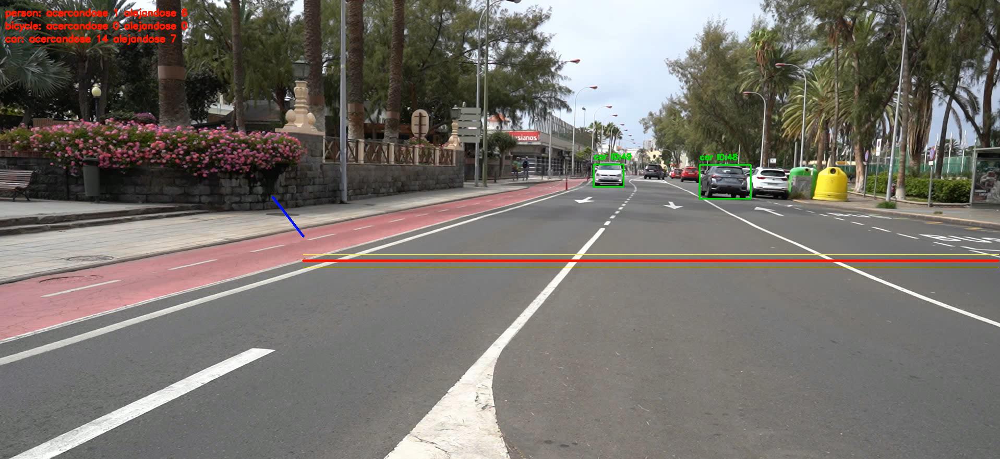
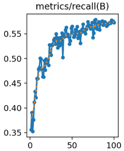
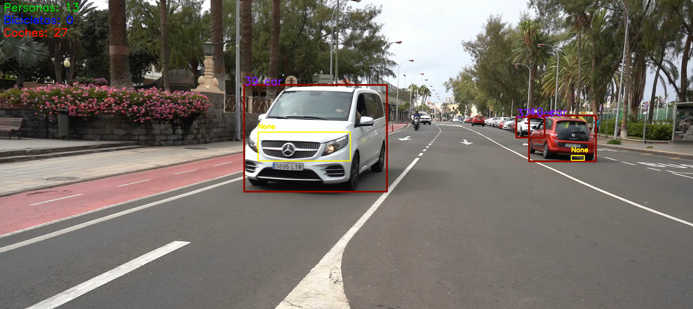
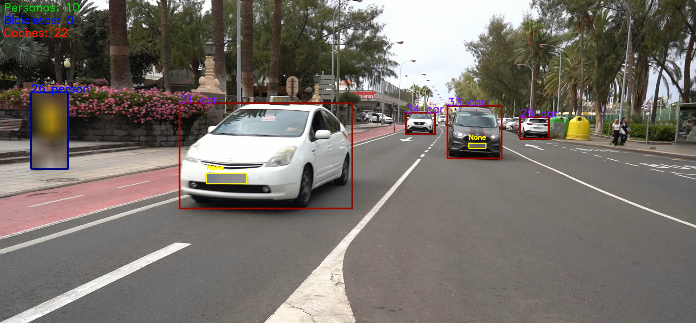

# Práctica 4 – Detección y seguimiento de vehículos y matrículas

## 1. Introducción

En esta práctica hemos desarrollado un sistema de visión por computador para analizar vídeos de tráfico. Lo que buscamos es detectar y seguir coches, personas, bicicletas y matrículas en este [vídeo](https\://drive.google.com/file/d/13_jrGrxRbnmeE6TLGrElZA5Xu7BUczPr/view?usp=drive_link). Os recomendamos hacer clic en las imágenes que aparecen a lo largo del documento, ya que llevan directamente al vídeo de cada apartado.

Para ello usamos YOLO como modelo de detección de objetos, tanto en su versión preentrenada como en una entrenada por nosotros para localizar matrículas. Además, hemos añadido varias funcionalidades: analizar el sentido de circulación, contar los objetos detectados y anonimizar ciertas zonas de los vídeos.

También se pueden usar dos métodos para localizar matrículas: un modelo YOLO entrenado con un conjunto de imágenes anotadas y otro basado en el análisis de contornos con OpenCV.

En la segunda parte de la práctica damos un paso más. Ya no nos basta con localizar la matrícula de cada vehículo: queremos leer los caracteres que aparecen en ella.

Para esto aprovechamos el detector YOLO desarrollado antes y le incorporamos modelos de reconocimiento de texto (OCR). Este apartado tiene dos partes. Primero integramos EasyOCR en el procesamiento del [vídeo de tráfico](https\://drive.google.com/file/d/13_jrGrxRbnmeE6TLGrElZA5Xu7BUczPr/view?usp=drive_link) que acabamos de mencionar, para intentar reconocer las matrículas y guardar los resultados. Después preparamos un conjunto de recortes de matrículas con sus textos reales para comparar EasyOCR con otro modelo, SmolVLM.

## 2. Instalaciones necesarias

Hay que instalar algunas librerías adicionales a las de los entornos que se indican en los [README de la práctica 4](https\://github.com/otsedom/otsedom.github.io/tree/main/VC/P4) y de la [práctica 4b](https\://github.com/otsedom/otsedom.github.io/tree/main/VC/P4b), que nos proporciona el profesor.

En concreto, para ejecutar todos los apartados necesitamos estas dependencias:

- ****EasyOCR:**** para reconocer los caracteres de las matrículas mediante OCR.

- ****Transformers:**** para cargar y usar el modelo SmolVLM.

Se instalan con estos comandos:

```bash
pip install easyocr
pip install transformers
```

## 3. Detección y seguimiento de objetos

Para detectar los elementos que aparecen en el vídeo usamos el modelo ****YOLO11n****, que nos permite identificar tres clases de objetos: personas, bicicletas y coches.

Con esas detecciones seguimos a los objetos a lo largo de los fotogramas. Así, cada elemento mantiene su propio identificador y podemos ver cómo se mueve durante el vídeo. Esto también evita que un mismo objeto se cuente varias veces cuando aparece en fotogramas distintos.

## 4. Análisis del sentido de circulación

Una de las funcionalidades que hemos implementado consiste en saber hacia dónde se desplazan los objetos detectados.

Para ello colocamos unas líneas de referencia sobre el vídeo y miramos cómo se mueven los objetos respecto a ellas. Según su movimiento, los clasificamos como objetos que se acercan o que se alejan.

Llevamos contadores independientes para personas, bicicletas y coches, de modo que al final tenemos un resumen del tráfico observado.

[](https\://drive.google.com/file/d/1HXbJKpnTgJLuS4aB-QNzveqdSc3nuR9y/view?usp=drive_link)

Viendo el vídeo, podemos confirmar que el conteo de personas y vehículos, y sus direcciones, es correcto.

## 5. Detección de matrículas

Para localizar las matrículas de los vehículos hemos implementado dos métodos distintos.

### 5.1. Detección mediante YOLO entrenado

Partimos de un modelo YOLO11n que entrenamos con el [dataset](https\://drive.google.com/drive/folders/1RFd6sKH_QMQcpE_w5rWmy8rKiYUY5_SI?usp=drive_link) creado por los compañeros de la asignatura, que contiene imágenes anotadas para la detección de matrículas.

Dividimos el conjunto de datos en tres particiones:

- ****Train:**** imágenes que usamos para entrenar (70%).

- ****Validation:**** imágenes que usamos para comprobar cómo se comporta el modelo mientras entrena (20%).

- ****Test:**** imágenes que reservamos para evaluar el modelo cuando termina el entrenamiento (10%).

El conjunto de datos tiene una única clase, llamada `matricula`.

Esta es la configuración que usamos para entrenar:

| Parámetro | Valor |
|---|---|
| Modelo inicial | YOLO11n |
| Épocas | 100 |
| Paciencia | 20 |
| Tamaño de imagen | 640 × 640 |
| Batch | 12 |
| Dispositivo | GPU, si está disponible; en caso contrario, CPU |

#### Evolución del entrenamiento

Para hacernos una idea de cómo ha ido aprendiendo el modelo, vamos a fijarnos en las gráficas que salieron durante el entrenamiento.

| Pérdida de localización | |
|---|---|
|  | Representa el error que se comete al localizar las matrículas durante el entrenamiento, comparando las cajas que predice el modelo con las anotaciones reales. Que baje poco a poco indica que el modelo es cada vez más preciso al delimitar las matrículas. Las pequeñas fluctuaciones que aparecen por el camino son normales. |
| Pérdida de clasificación | |
|  | Mide el error al clasificar los objetos detectados. Cae muy rápido en las primeras épocas y después baja de forma más gradual. Esto indica que el modelo aprende enseguida a reconocer la clase y que sigue mejorando a medida que avanza el entrenamiento. |
| Distribution Focal Loss | |
|  | Mide el error relacionado con la precisión de las coordenadas de las cajas. Su evolución descendente indica que el modelo va ajustando cada vez mejor la posición de las matrículas. Igual que pasa con box_loss, las pequeñas oscilaciones no impiden ver una tendencia clara de mejora. |
| Precisión | |
|  | Indica qué proporción de las detecciones del modelo son correctas. La gráfica sube de forma progresiva hasta valores cercanos a 0,88. Esto significa que la mayoría de las matrículas que detecta son válidas y que hay relativamente pocos falsos positivos. |
| Exhaustividad | |
|  | Mide qué proporción de las matrículas que hay en las imágenes consigue detectar el modelo. Va subiendo poco a poco hasta situarse cerca de 0,58. Aunque evoluciona bien, la diferencia con la precisión nos dice que todavía hay matrículas reales que el modelo no llega a detectar. |
| Pérdida de localización en validación | |
|  | Representa el error de localización al evaluar el modelo sobre el conjunto de validación, que son imágenes que no se usan directamente para actualizar sus parámetros durante el entrenamiento. Que baje indica que el modelo también mejora al localizar matrículas en estos datos. La evolución es parecida a la del conjunto de entrenamiento. |
| Pérdida de clasificación en validación | |
|  | Muestra el error de clasificación sobre el conjunto de validación. Cae mucho en las primeras épocas y luego baja de forma más suave. Esto refleja que el modelo mejora su capacidad de clasificar bien las detecciones en imágenes distintas a las de entrenamiento. |
| Distribution Focal Loss en validación | |
|  | Mide el error relacionado con la precisión de las cajas sobre el conjunto de validación. Su tendencia a la baja indica que el modelo también va mejorando la localización de las matrículas en estos datos. Se comporta de forma parecida a las pérdidas de localización del entrenamiento. |
| Calidad de detección (mAP@0.5) | |
|  | Evalúa el rendimiento global del detector usando un umbral de coincidencia IoU de 0,50 entre las cajas predichas y las reales. La gráfica crece de forma progresiva hasta alcanzar aproximadamente 0,57. Esto indica que, a lo largo del entrenamiento, el modelo va siendo mejor detectando matrículas en general. |
| Calidad de detección (mAP@0.5-0.95) | |
|  | Evalúa el rendimiento con distintos umbrales de coincidencia, de 0,50 a 0,95, así que es una métrica más exigente que mAP50. Termina el entrenamiento en torno a 0,31. Que sea más baja refleja lo difícil que es conseguir cajas que se ajusten con precisión a las matrículas. |

#### Conclusiones del entrenamiento

Las gráficas muestran que el modelo ha ido aprendiendo de forma progresiva. El error al localizar las matrículas baja durante todo el entrenamiento, y tanto la precisión como la calidad de las detecciones mejoran bastante respecto a las primeras épocas. También se ve que las mayores mejoras llegan al principio; a partir de ahí los resultados se van estabilizando y los avances son más pequeños. Es lo esperable, ya que el modelo ya ha aprendido buena parte de lo que necesita para hacer las detecciones.

Cuando termina el entrenamiento, nos quedamos con el mejor modelo obtenido (`best.pt`) para hacer las detecciones.

[](https\://drive.google.com/file/d/1fr9FyrUlhC3aFWQFUCrxtBt63apLq9d9/view?usp=drive_link)

En el vídeo se ve que la detección de matrículas funciona bien cuando los coches están razonablemente cerca de la cámara.

### 5.2. Detección mediante contornos

Como alternativa al modelo entrenado, hemos implementado un método de detección basado en procesamiento de imágenes con OpenCV. Primero localizamos los coches con YOLO11n y, después, analizamos por separado la región de cada vehículo para intentar encontrar su matrícula.

Estos son los pasos que seguimos:

1. Convertimos la región del vehículo a escala de grises.

2. Aplicamos un desenfoque gaussiano para reducir el ruido.

3. Usamos el detector de bordes Canny para localizar los cambios de intensidad.

4. Aplicamos una operación morfológica de cierre para unir regiones cercanas.

5. Extraemos los contornos y analizamos sus dimensiones y proporciones.

Por último, nos quedamos con los candidatos que cumplen ciertos criterios, como el ancho, el alto, la relación de aspecto y el área.

[](https\://drive.google.com/file/d/1MFGXNq1IREiWNRUBbVmPf3CbteWJaglQ/view?usp=drive_link)

Con este método conseguimos localizar muy pocas matrículas, y sus resultados son menos consistentes que los del modelo entrenado. Esto se debe sobre todo a que otras partes del vehículo, como elementos de la carrocería o las sombras, pueden tener características geométricas parecidas a las de una matrícula.

Al ejecutar el programa aparece una caja de texto en la que el usuario decide si la detección se hace por contornos o no. Gracias a este sistema de preguntas al usuario, podemos tener muchas funcionalidades distintas en un código compacto.

## 6. Anonimización de matrículas y personas

También hemos añadido una funcionalidad de anonimización que aplica un desenfoque gaussiano sobre las zonas de las matrículas y de las personas detectadas. Para usarla, cuando el programa pregunte si queremos aplicar el análisis de contornos, hay que responder `n`. Después preguntará si queremos anonimizar las personas y las matrículas detectadas, y ahí hay que responder `s`.

Para las matrículas usamos el modelo entrenado, mientras que a las personas las localizamos con el modelo YOLO11n general. Una vez que tenemos las regiones, les aplicamos un desenfoque gaussiano con un tamaño de kernel de 51 × 51 y una desviación estándar de 30.

En el caso de las matrículas, además, las relacionamos con los vehículos correspondientes. Para eso comprobamos si el centro de la matrícula está dentro de la región delimitada por el vehículo.

Cuando hay varias matrículas asociadas a un mismo coche, nos quedamos con la que tiene mayor confianza.

[](https\://drive.google.com/file/d/17tH8DFem0tviKMhNdJ4toys-J3yxdseT/view?usp=drive_link)

En el vídeo se ve que la anonimización es indiscutible: si se detecta un objeto, se le aplica automáticamente un desenfoque gaussiano, así que la funcionalidad es efectiva.

## 7. Archivo CSV

Cuando usamos el método de detección de matrículas con YOLO, se genera el archivo `C0142_resultados.csv`.

Este archivo recoge información de las detecciones hechas mientras se procesa el vídeo, en concreto:

- Número de fotograma.

- Tipo de objeto detectado.

- Confianza de la detección.

- Identificador de seguimiento.

- Coordenadas de la región detectada.

- Información asociada a la matrícula localizada.

Así conservamos los resultados del procesamiento para consultarlos y analizarlos más adelante. Se puede ver [aquí](P4/C0142_resultados.csv).

Al revisar el documento, vemos que solo consigue detectar correctamente 2 matrículas.

## 8. – Reconocimiento de caracteres en matrículas

### 8.1. Reconocimiento de matrículas mediante EasyOCR

Una vez que tenemos el detector entrenado, lo incorporamos al procesamiento del [vídeo de tráfico](https\://drive.google.com/file/d/13_jrGrxRbnmeE6TLGrElZA5Xu7BUczPr/view?usp=drive_link). La idea es que, cuando se localice una matrícula, podamos extraer su contenido y mostrarlo sobre el propio vídeo.

Para ello mantenemos el detector general de objetos y el seguimiento de vehículos de la primera parte, y además usamos el modelo YOLO entrenado para localizar las matrículas en cada fotograma.

Cuando encontramos una matrícula, recortamos la región y preparamos la imagen antes de pasársela a EasyOCR. Esta preparación consta de los siguientes pasos:

1. Convertimos el recorte a escala de grises para trabajar con la información de intensidad de la imagen.

2. Lo ampliamos cinco veces con interpolación cúbica, para facilitar la lectura de los caracteres.

3. Mejoramos el contraste con CLAHE, para intentar distinguir mejor los caracteres del fondo.

4. Enviamos el resultado a EasyOCR, limitando los caracteres posibles a números y letras mayúsculas.

EasyOCR puede devolver varias lecturas para un mismo recorte. Cuando pasa esto, nos quedamos con la que tiene más confianza. El texto reconocido se muestra sobre el vídeo, junto a la matrícula detectada.

El resultado se guarda en un vídeo en el que se ven los vehículos, las matrículas y el texto. Además, se genera el archivo [`C0142_resultados_Ocr.csv`](P4b/C0142_resultados_Ocr.csv), que recoge información de las detecciones, como el fotograma, el tipo de objeto, la confianza, el identificador de seguimiento, las coordenadas y, cuando corresponde, el texto leído de la matrícula.

[](https\://drive.google.com/file/d/1OGcTvxMkdin4ORqLh6psXltF3jeOfmgq/view?usp=drive_link)

En el vídeo se ve que, en la mayoría de los casos, no se llega a interpretar bien el texto de las matrículas.

### 8.2. Preparación del conjunto para la evaluación OCR

Para comparar los dos modelos OCR necesitamos imágenes cuyo contenido real conozcamos. Por eso preparamos un dataset más pequeño, con 975 recortes de matrículas, a partir de las imágenes y las anotaciones JSON del conjunto de datos creado por la clase que ya hemos mencionado ([acceso](https\://drive.google.com/drive/folders/1RFd6sKH_QMQcpE_w5rWmy8rKiYUY5_SI?usp=drive_link)).

Lo importante es que tanto EasyOCR como SmolVLM se evalúan con exactamente estos mismos recortes y las mismas referencias.

El archivo [`matriculas_reales.csv`](P4b/matriculas_reales.csv) contiene la información de los recortes y de las matrículas reales que usamos en la evaluación.

### 8.3. Evaluación de EasyOCR

El primer modelo que evaluamos es ****EasyOCR****, una herramienta que reconoce caracteres y extrae texto directamente de una imagen.

Procesamos cada uno de los 975 recortes y comparamos el texto obtenido con la matrícula real. Además de comprobar si la lectura es correcta, medimos el tiempo.

Estos son los resultados:

| Métrica | Resultado |
|---|---:|
| Imágenes evaluadas | 975 |
| Predicciones correctas | 259 |
| Predicciones incorrectas | 716 |
| Predicciones vacías | 118 |
| Exact Match | ****26,56 %**** |
| CER | ****45,77 %**** |
| Tiempo total | 30,78 s |
| Tiempo medio por imagen | ****31,57 ms**** |

Con estos números vemos que EasyOCR solo consigue reconocer correctamente 259 de las 975 matrículas. Eso es un ****26,56 % de aciertos exactos****, así que en bastantes imágenes se equivoca en uno o varios caracteres. Además, hay que tener en cuenta que 118 predicciones están vacías.

Para valorar los errores con más detalle usamos el ****Character Error Rate (CER)****. Esta métrica compara los caracteres reconocidos con los reales y tiene en cuenta los que se han sustituido, insertado o eliminado. Cuanto menor es el CER, mejor es el resultado. Aquí obtenemos un ****45,77 %****, lo que refleja lo que le ha costado a EasyOCR leer bien las matrículas.

Donde sí destaca claramente es en la velocidad. Procesar los 975 recortes le lleva unos 31 segundos, con una media de apenas 31,57 milisegundos por imagen. Así que, aunque sus resultados de reconocimiento no son especialmente buenos, es un modelo muy rápido.

### 8.4. Evaluación de SmolVLM

Como alternativa a EasyOCR probamos ****SmolVLM-256M-Instruct****, un VLM de 256 millones de parámetros, la versión pequeña de SmolVLM. A diferencia de un OCR tradicional, este modelo puede interpretar el contenido de una imagen y responder a una instrucción sobre ella.

En este caso le damos cada recorte junto con una indicación (`prompt`) para que identifique los caracteres de la matrícula y nos devuelva el texto reconocido.

Estos son los resultados:

| Métrica | Resultado |
|---|---:|
| Modelo | SmolVLM-256M-Instruct |
| Parámetros | 256 millones |
| Imágenes evaluadas | 975 |
| Predicciones correctas | 587 |
| Predicciones incorrectas | 388 |
| Predicciones vacías | 0 |
| Exact Match | ****60,21 %**** |
| CER | ****15,58 %**** |
| Tiempo total | 27 min 18 s |
| Tiempo medio por imagen | ****1,68 s**** |

Aquí el reconocimiento mejora bastante. SmolVLM lee correctamente 587 matrículas, un ****60,21 % de aciertos exactos****. Son 328 matrículas más que las que reconoce bien EasyOCR con exactamente las mismas imágenes.

La diferencia también se nota en el CER, que baja hasta el ****15,58 %****. Es decir, sus predicciones tienen bastantes menos errores de caracteres y se parecen mucho más al texto real.

El gran inconveniente aparece al medir el tiempo. Procesar las 975 imágenes lleva ****27 minutos y 18 segundos****, con una media de 1,68 segundos por recorte. Es bastante más que EasyOCR, así que la mejora en el reconocimiento se paga con un coste importante en velocidad.

### 8.5. Comparación de resultados

Para valorar las diferencias nos fijamos sobre todo en tres aspectos:

- ****Exact Match:**** indica el porcentaje de matrículas reconocidas por completo y sin ningún carácter incorrecto. Cuanto mayor sea, mejor.

- ****CER:**** mide los errores que se cometen al comparar los caracteres reconocidos con los reales. Aquí interesa que sea lo más bajo posible.

- ****Tiempo medio de inferencia:**** indica cuánto tarda cada modelo en procesar un recorte. Cuanto menor sea, más rápido es.

#### Comparación de métricas

| Métrica | EasyOCR | SmolVLM |
|---|---:|---:|
| Imágenes evaluadas | 975 | 975 |
| Predicciones correctas | 259 | ****587**** |
| Predicciones incorrectas | 716 | ****388**** |
| Predicciones vacías | 118 | ****0**** |
| Exact Match | 26,56 % | ****60,21 %**** |
| CER | 45,77 % | ****15,58 %**** |
| Tiempo total | ****30,78 s**** | 27 min 18 s |
| Tiempo medio | ****31,57 ms**** | 1,68 s |

#### Comparación gráfica

Las siguientes gráficas dejan ver con más claridad las diferencias entre los dos modelos en aciertos exactos, errores por carácter y tiempo de procesamiento.

****Exact Match****


****CER****


****Tiempo medio de procesamiento****


#### Análisis de los resultados

La diferencia más importante está en el reconocimiento de matrículas completas. SmolVLM alcanza un Exact Match del ****60,21 %****, mientras que EasyOCR se queda en el ****26,56 %****. Eso supone una diferencia del 33,65 %.

También hay una diferencia considerable en el CER: SmolVLM obtiene un 15,58 %, frente al 45,77 % de EasyOCR. Por tanto, no solo consigue más lecturas exactas, sino que en general comete menos errores al reconocer los caracteres.

Sin embargo, con los tiempos pasa justo lo contrario. EasyOCR necesita una media de 31,57 milisegundos por imagen, mientras que SmolVLM tarda 1,68 segundos. En definitiva, SmolVLM tarda muchísimo más en procesar cada recorte.

EasyOCR es mucho más rápido, pero le cuesta bastante leer bien las matrículas de este conjunto de imágenes. SmolVLM da resultados de reconocimiento mucho mejores, pero a cambio tarda mucho más.

Por eso, en esta comparación no hay un ganador absoluto. Si lo más importante es procesar muchas imágenes rápido, EasyOCR es más adecuado. En cambio, si lo que prima es conseguir lecturas más correctas y se puede asumir una espera mayor, SmolVLM da mejores resultados.

#### Especificaciones del equipo

Hicimos las pruebas con el siguiente equipo:

| Componente | Especificación |
|---|---|
| GPU | NVIDIA GeForce RTX 2060 |
| Memoria de GPU | 6 GB |
| RAM | 32 GB |
| PyTorch | 2.4.1 |
| CUDA | 12.1 |

### 9. Bibliografía y enlaces de interes

[Acceso a todos los vídeos creados durante la práctica](https\://drive.google.com/drive/folders/1FJGJGkTo87uCqMuZWZ0ne6dZ1KV74765?usp=drive_link)

[ChatGPT](https\://chatgpt.com/): utilizado para comprobar errores ortográficos y gramaticales.

[Claude](https\://claude.ai/): utilizado para hacer resúmenes, explicaciones y ejemplos cortos sobre la documentación de los paquetes.